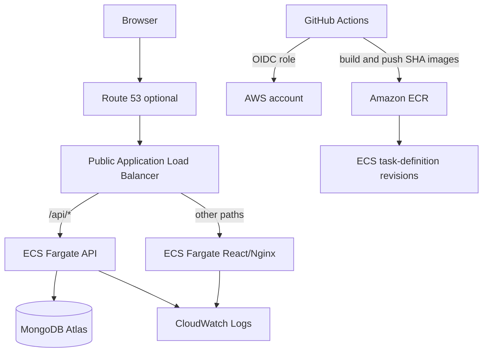

# Homaid — Home Services Booking Platform on AWS

A full-stack booking application built with React.js, Node.js REST APIs and MongoDB. Separate Docker images are stored in Amazon ECR and run on Amazon ECS Fargate. Terraform provisions the VPC, ALB, ECS services, IAM, ECR, CloudWatch and optional Route 53 DNS. GitHub Actions uses GitHub OIDC for short-lived AWS credentials.

> **Implementation status:** Application code, Docker configuration, Terraform and GitHub Actions are source-controlled. A live AWS deployment and the resume's “under 6 minutes” deployment claim are **not yet verified**. No AWS resources are provisioned by this repository automatically.

## Resume-aligned implementation

| Resume item | Repository implementation |
|---|---|
| React.js / Node.js / MongoDB | React booking UI, Express REST API, MongoDB |
| Docker | Separate web and API Dockerfiles |
| ECR / ECS | Two ECR repositories; two ECS Fargate services |
| Terraform | VPC, public/private subnets, ALB, ECS, IAM, ECR, Route 53 option |
| GitHub Actions | API tests, frontend build, Docker build, ECR push, ECS task-definition update and rollout wait |
| CloudWatch | ECS log groups, Container Insights and ALB alarms |
| Route 53 | Optional ALB alias record for an existing hosted zone |

MongoDB is external (MongoDB Atlas or an approved private MongoDB endpoint); it is not silently replaced with RDS. For Atlas, allowlist the NAT egress IP or configure private connectivity.

## Architecture



ECS tasks use private subnets without public IPs. The ALB is public. The sample uses one NAT Gateway to reduce fixed networking cost; this is a learning trade-off, not multi-AZ NAT resilience.

## Repository structure

- `api/`: booking API, domain validation, state transitions and tests.
- `web/`: React application and Nginx reverse proxy.
- `infra/terraform/`: VPC, ALB, ECS/Fargate, ECR, IAM, logs, alarms and Route 53 option.
- `.github/workflows/ci.yml`: pull-request validation and opt-in AWS deployment.
- `docs/`: architecture, deployment, security, runbook, costs and measurement notes.

## Run locally

Requirements: Node.js 22 and Docker Compose v2.

```bash
cp .env.example .env
# Replace ADMIN_API_TOKEN with a long random value.
docker compose up --build
```

Open http://localhost:8080. The local Compose stack includes MongoDB. The API is proxied through the web container at `/api`.

API tests:

```bash
cd api
npm install
npm test
npm run check
```

## AWS deployment

Read [deployment](docs/deployment.md), [security](docs/security.md) and [costs](docs/costs.md) before applying Terraform. Configure encrypted remote state, AWS identity, GitHub OIDC and MongoDB access first. Never commit `terraform.tfvars`, state files, MongoDB connection strings or admin tokens.

After Terraform creates the ECS services, store values in the two Secrets Manager secret containers. The first successful GitHub Actions deployment publishes the initial image tags and registers immutable task-definition revisions pointing to that commit SHA.

## Evidence discipline

The resume lists deployment in under 6 minutes. This project contains a measurement template but does not claim that duration until multiple successful runs are recorded with comparable start/end definitions. See [metrics](docs/metrics.md).
