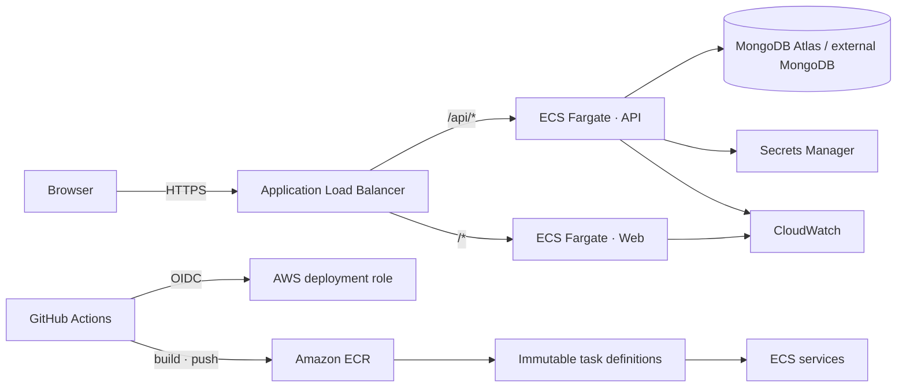

# Homaid — Home Services Booking Platform on AWS

> **Portfolio project · AWS ECS Fargate · Terraform · GitHub Actions**

Homaid is a full-stack home-services booking application delivered as two containerized workloads on Amazon ECS Fargate. This repository demonstrates the path from application code to repeatable infrastructure, immutable container artifacts, controlled releases, and operational visibility.

## At a glance

| Area | Implementation |
|---|---|
| Application | React frontend · Node.js/Express REST API · MongoDB |
| Runtime | Amazon ECS on AWS Fargate (web + API services) |
| Networking | VPC, public ALB, public/private subnets, NAT egress |
| Delivery | GitHub Actions → OIDC → ECR → ECS task-definition revision |
| Infrastructure | Terraform |
| Operations | CloudWatch Logs, Container Insights, ALB/ECS alarms |
| Secrets | AWS Secrets Manager (runtime injection) |

## Architecture



## Repository map

```text
.
├── api/                    # REST API, domain logic and tests
├── web/                    # React app and Nginx reverse proxy
├── infra/terraform/         # VPC, ALB, ECS, IAM, ECR, logs and alarms
├── .github/workflows/ci.yml # Validation and opt-in AWS release workflow
├── docs/
│   ├── architecture.md
│   ├── deployment.md
│   ├── security.md
│   ├── runbook.md
│   ├── costs.md
│   └── metrics.md
└── docker-compose.yml        # Local development stack
```

## Delivery lifecycle

1. **Develop** — change API or frontend; run focused tests locally.
2. **Validate** — pull-request workflow runs API tests/checks and frontend build.
3. **Package** — build separate web/API images and tag them with the commit SHA.
4. **Publish** — authenticate to AWS through GitHub OIDC; push immutable images to ECR.
5. **Release** — register task-definition revisions and update ECS services.
6. **Verify** — wait for service stability and inspect target health/logs/alarms.
7. **Recover** — redeploy a known-good task-definition revision and confirm health.

See [deployment guide](docs/deployment.md) for setup and release commands, [security](docs/security.md) for trust boundaries, and [runbook](docs/runbook.md) for incident triage.

## Local development

Prerequisites: Node.js 22, Docker and Docker Compose v2.

```bash
cp .env.example .env
# Set a strong local ADMIN_API_TOKEN in .env
docker compose up --build
```

Open http://localhost:8080. Compose starts the web, API and local MongoDB services.

```bash
cd api && npm ci && npm test && npm run check
cd ../web && npm ci && npm run build
```

## Infrastructure and deployment

Terraform provisions the AWS foundation; the GitHub Actions AWS deployment is intentionally **opt-in**. Before applying, configure remote state with locking/encryption, review the plan, configure GitHub OIDC trust, and populate runtime secret values in Secrets Manager. See [deployment](docs/deployment.md).

MongoDB remains MongoDB (Atlas or an approved private endpoint); it is not silently substituted with RDS. For Atlas, configure network access for the workload's egress or use private connectivity.

## Evidence and scope

- Source, tests, Terraform and CI/CD configuration are version-controlled.
- GitHub Actions validation is repeatable; inspect the Actions tab for the latest run.
- A live AWS deployment, end-to-end production traffic, and the resume's **under-six-minute** release metric are not asserted until deployment evidence and repeatable measurements are recorded.
- NAT Gateway, ALB, Fargate, and CloudWatch can incur charges. Review [cost guidance](docs/costs.md), use budgets, and destroy lab resources when finished.

## Project intent

This is a practical portfolio implementation of AWS container delivery and operations—not a claim of a continuously running production service. The repository favors traceable changes, least privilege, explicit setup, and verifiable evidence over screenshots or unmeasured performance claims.
