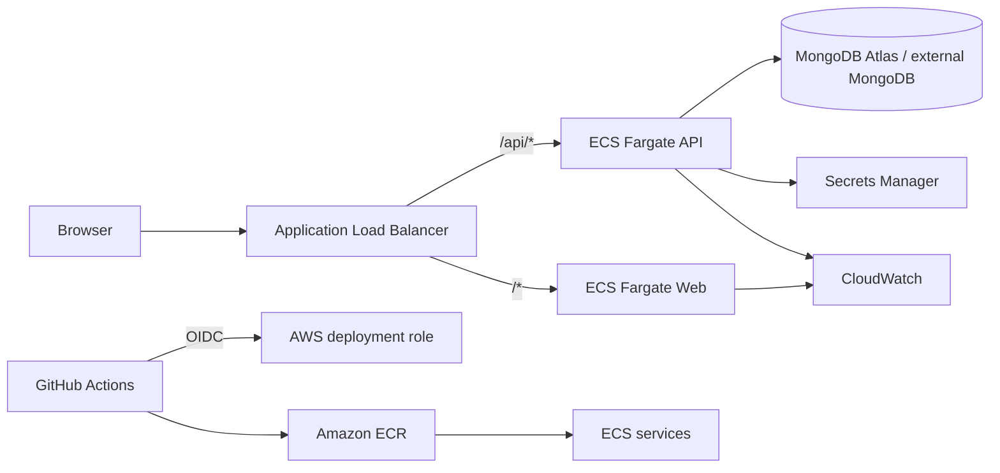

# Homaid — Home Services Booking Platform on AWS

> **Portfolio project · AWS ECS Fargate · Terraform · GitHub Actions**

Homaid is a full-stack home-services booking application delivered as two containerized workloads on Amazon ECS Fargate. The repository demonstrates the path from application code to repeatable infrastructure, immutable container artifacts, controlled releases, and operational visibility.

## At a glance

| Area | Implementation |
|---|---|
| Application | React frontend · Node.js/Express REST API · MongoDB |
| Runtime | Amazon ECS on AWS Fargate (web + API services) |
| Networking | VPC, public ALB, public/private subnets, NAT egress |
| Delivery | GitHub Actions → OIDC → ECR → ECS task-definition revision |
| Infrastructure | Terraform |
| Operations | CloudWatch Logs, Container Insights, ALB/ECS alarms |
| Secrets | AWS Secrets Manager (runtime injection) |

## Architecture



## Repository structure

```text
.
├── api/                     # REST API, domain logic and tests
├── web/                     # React app and Nginx reverse proxy
├── infra/terraform/          # VPC, ALB, ECS, IAM, ECR, logs and alarms
├── .github/workflows/ci.yml  # Validation and opt-in AWS release workflow
├── docs/                     # Architecture, deployment, security and runbooks
└── docker-compose.yml        # Local development stack
```

## Delivery lifecycle

1. **Develop** — change the API or frontend and run focused tests locally.
2. **Validate** — pull-request workflow runs API tests/checks, frontend build, Compose validation, Terraform validation and Docker builds.
3. **Package** — build separate web/API images and tag them with the commit SHA.
4. **Publish** — authenticate to AWS through GitHub OIDC and push immutable images to ECR.
5. **Release** — register task-definition revisions and update the ECS services.
6. **Verify** — wait for ECS stability and inspect target health, readiness, logs and alarms.
7. **Recover** — redeploy a known-good task-definition revision and confirm service health.

Useful guides: [deployment](docs/deployment.md) · [security](docs/security.md) · [operations and acceptance](docs/operations-acceptance.md) · [incident runbook](docs/runbook.md) · [costs](docs/costs.md) · [metrics](docs/metrics.md).

## Local development

Prerequisites: Node.js 22, Docker and Docker Compose v2.

```bash
cp .env.example .env
# Set a strong local ADMIN_API_TOKEN in .env
docker compose up --build
```

Open http://localhost:8080. Compose starts the web, API and local MongoDB services.

```bash
cd api && npm ci && npm test && npm run check
cd ../web && npm ci && npm run build
```

## AWS infrastructure and deployment

Terraform provisions the AWS foundation. The GitHub Actions AWS deployment is intentionally opt-in and runs only on the configured main-branch release path. Before applying, configure encrypted remote state with locking, review the Terraform plan, configure GitHub OIDC trust, and populate runtime secret values in Secrets Manager.

MongoDB remains MongoDB (Atlas or an approved private endpoint); it is not silently substituted with RDS. For Atlas, configure network access for the workload's egress or use private connectivity.

## Implementation status and evidence

- Application code, tests, Docker configuration, Terraform and CI/CD definitions are source-controlled.
- Repository validation is repeatable through GitHub Actions; inspect the Actions tab for the latest run.
- A green CI run is not evidence of a live AWS deployment. The deployment workflow is skipped until AWS account variables, OIDC trust and provisioned resources are configured.
- The resume's **under-six-minute** release metric remains unverified until real deployment timestamps are collected consistently across multiple releases.
- The baseline ALB listener is HTTP. Configure ACM, HTTPS and an HTTP-to-HTTPS redirect before using a public production domain.
- The single NAT Gateway is a cost-optimized learning trade-off, not a multi-AZ resilience design. ALB, NAT, Fargate and CloudWatch can incur ongoing charges; use budgets and destroy lab resources when finished.

## Project intent

This is a practical portfolio implementation of AWS container delivery and operations, not a claim of a continuously running production service. The repository favors traceable changes, least privilege, explicit setup, and verifiable evidence over unmeasured performance claims.
