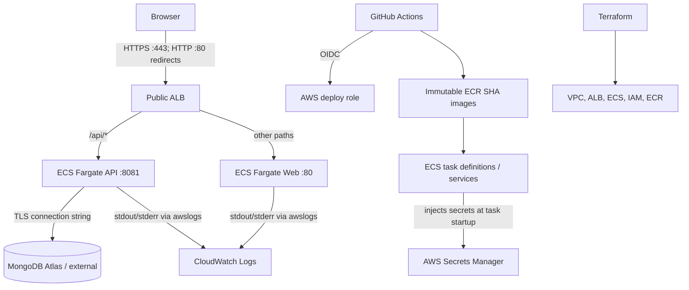

# Architecture

## Runtime request path

1. A browser resolves the optional Route 53 alias to the public Application Load Balancer.
2. The ALB forwards `/api/*` requests to the API target group on TCP 8081; other paths go to the web target group on TCP 80.
3. The ECS web container serves the React build through Nginx. The ALB—not Nginx—routes `/api/*` directly to the separate API target group, so ECS does not depend on a Compose-only `api` DNS name. ECS web `/health` is a local liveness response. Local Docker Compose selects `web/nginx-compose.conf`, which retains the `api:8081` reverse proxy and exposes API readiness on the web origin. The API connects to MongoDB Atlas (or another configured MongoDB endpoint) using a URI injected from AWS Secrets Manager.
4. ECS sends container logs to CloudWatch Logs. Container Insights and ALB metrics provide operational signals.

## Runtime topology

## Network and security boundaries

- ALB subnets are public across two Availability Zones; ECS tasks use private subnets without public IPs.
- A single NAT Gateway provides task egress to MongoDB Atlas and package endpoints. It reduces fixed cost but creates an AZ dependency.
- The task security group accepts web/API ports only from the ALB security group.
- GitHub Actions assumes an immutable repository-ID and environment-scoped IAM role through OIDC. The `aws-production` environment must restrict deployments to `main`; no long-lived AWS access key is required.
- Terraform provisions the HTTPS listener on 443 and an HTTP listener on 80 that redirects to HTTPS. An issued ACM certificate matching the configured hostname, DNS validation, and live TLS/redirect acceptance are deployment prerequisites.

## Release path

A push to `main` or a manual `workflow_dispatch` against `main` runs repository validation. If AWS repository variables are configured and the `aws-production` environment permits the branch, GitHub Actions obtains short-lived credentials, builds and pushes commit-SHA images to ECR, registers ECS task-definition revisions, updates both services and waits for stability. Both ECS services (API and web) have deployment circuit-breaker rollback enabled.
