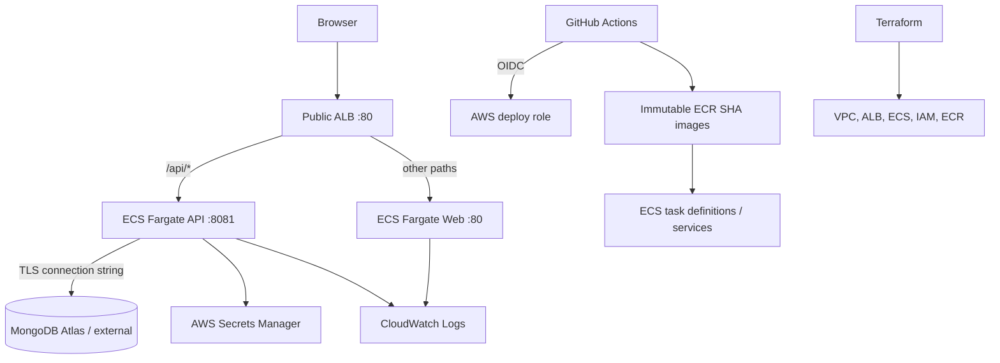

# Architecture

## Runtime request path

1. A browser resolves the optional Route 53 alias to the public Application Load Balancer.
2. The ALB forwards `/api/*` requests to the API target group on TCP 8081; other paths go to the web target group on TCP 80.
3. The web container serves the React build through Nginx. The API connects to MongoDB Atlas (or another configured MongoDB endpoint) using a URI injected from AWS Secrets Manager.
4. ECS sends container logs to CloudWatch Logs. Container Insights and ALB metrics provide operational signals.

## Runtime topology

## Network and security boundaries

- ALB subnets are public across two Availability Zones; ECS tasks use private subnets without public IPs.
- A single NAT Gateway provides task egress to MongoDB Atlas and package endpoints. It reduces fixed cost but creates an AZ dependency.
- The task security group accepts web/API ports only from the ALB security group.
- GitHub Actions assumes a repository/ref-scoped IAM role through OIDC; no long-lived AWS access key is required.
- The baseline listener is HTTP. Configure ACM, HTTPS and redirect before a public production domain.

## Release path

A push to `main` runs repository validation. If AWS repository variables are configured, GitHub Actions obtains short-lived credentials, builds and pushes commit-SHA images to ECR, registers ECS task-definition revisions, updates both services and waits for stability. ECS deployment circuit breakers roll back failed service deployments.

## Evidence boundary

Terraform and workflow files describe the deployment. GitHub validation proves checks and image builds; it does not prove AWS resources were applied or a live ECS rollout occurred.